# StrayClawd

<p align="center">
  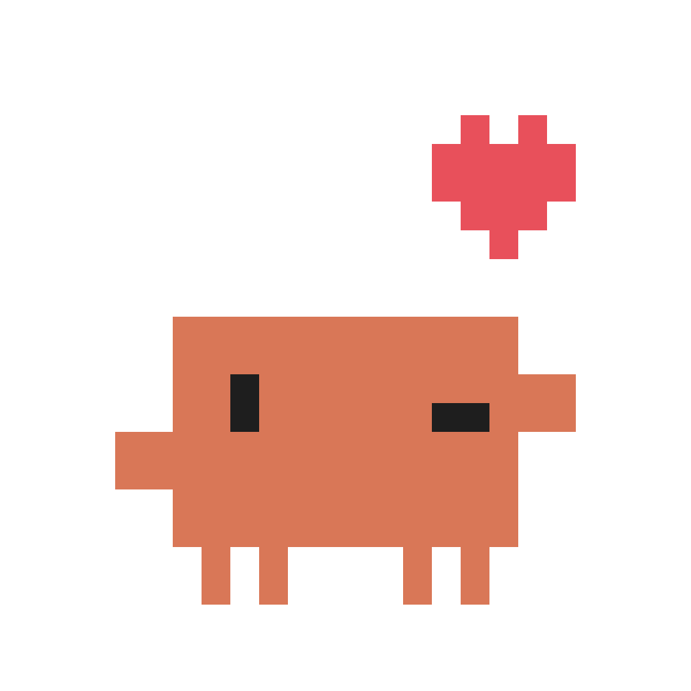
</p>

A desktop pet for Windows, in the spirit of the old Screen Mate Poo: the small orange pixel
crab of Claude appears at random from behind one of your windows, sits on its title bar,
types on a tiny keyboard and does small cute things, then hides again.

Pure Win32 + GDI, C++20, no external library. One small exe, no install.

## Build

Needs Visual Studio 2026 (or Build Tools 2026) with the C++ x64 tools, and CMake.

```
build.cmd
```

Output: `build\clawdmate.exe`. `build.cmd` finds MSVC with vswhere. If vcvars does not find
the Windows SDK (missing registry entry), it takes the newest SDK found under
`C:\Program Files (x86)\Windows Kits\10`.

## Run

Start `build\clawdmate.exe`. The crab shows up after 3 s, then at random times.
Starting the exe a second time makes the running crab appear now.

Tray icon (right click):

- Show now / Hide
- Play: start an animation now (Peek, Parachute, DIY on a ladder, Paint, Magic, Cook, Dizzy,
  Fishing, Reading, Juggling, Watering the plant, Fitness, Skateboard, Rain and rainbow,
  Coffee, Yawn)
- Type along with me / Today is a party day
- Frequency: Rare (5-15 min), Normal (1-5 min), Often (20-60 s)
- Pause
- Start with Windows (`HKCU\Software\Microsoft\Windows\CurrentVersion\Run\StrayClawd`)
- Quit

Double click on the tray icon = Show now. Right click on the crab opens the same menu.
Settings are stored in `HKCU\Software\StrayClawd`.

## What the crab does

- Peeks from behind the top edge of a window (or from behind its left/right side), looks
  around, sometimes gets shy and goes back, otherwise climbs out with a hop.
- Then 4 to 8 activities: typing on a keyboard (code glyphs pop up), walking along the edge,
  waving at the mouse, following the mouse with its eyes, dancing, sleeping (wakes up when
  the mouse comes close), thinking, sneezing.
- Short special animations, picked at random among the activities:
  - DIY: puts on a hard hat, climbs a small ladder and hammers; the ladder vanishes and he
    falls down, dizzy for a moment.
  - Painter: beret and brush; he looks toward the wallpaper and paints a small copy of your
    real wallpaper on an easel.
  - Magician: top hat and wand; shooting stars, then a bow.
  - Cook: chef toque and a frying pan; vegetables jump in the pan, steam rises.
  - Fishing from the window edge: the line goes down into the window; a fish or an old boot.
  - Reading with glasses, turning pages.
  - Juggling three balls; sometimes one falls on his head.
  - Watering a small plant. It grows one step per watering (up to a flower) and starts
    again from a seed each day.
  - Fitness: push-ups, then a barbell, with sweat drops.
  - Skateboard along the edge, with a jump at the end.
  - Rain: he opens an umbrella, then a rainbow appears.
- Time of day: coffee in the morning (6-11 h), yawns after lunch and in the evening, more
  sleep and a nightcap at night (21-6 h).
- Seasons: Santa hat and snow in December, witch hat from 24 to 31 October, party hat and
  confetti on 1 January and on your party day (tray: "Today is a party day").
- He sits more often on the window you are using.
- Sometimes, when the cursor comes near and just above him, he chases it along the edge and
  jumps to catch it.
- "Type along with me" (tray, off by default): when you type, he types with you, one claw
  per key press. It uses a low-level keyboard hook that only counts key presses; it never
  reads which key.
- Sometimes, when the cursor comes near, he stops and stares at it. Not every time: 30 %
  chance, then a pause of 15-30 s. If you circle the cursor around him while he stares, he
  gets dizzy.
- Sometimes (15 % of the visits) he arrives by parachute from the top of a screen down to
  the taskbar.
- If another window covers him for 2 s, he leaves and comes back elsewhere a bit later.
- Waves goodbye and slides back behind the window.
- If no window edge is free (for example a maximized window), it uses the top of the taskbar.
- Follows the window when you move it. Falls when the window is minimized or closed.
- Click: hop with hearts, happy wiggle, or it runs away.
- Drag and drop: grab it, throw it; it lands on the first window top edge below, or on the
  taskbar.

## How it works

- `src/Mate.cpp`: layered window (`UpdateLayeredWindow`, per-pixel alpha), the state machine
  and the activities. To "come from behind" a window, the crab window is put just below the
  target window in the z-order (`SetWindowPos(crab, target)`), then slides up: Windows draws
  the real window over the hidden part. Once out, it is kept just above the target.
- `src/Canvas.cpp`: the crab is drawn in code, pixel by pixel, from a `Pose` (eyes, claws,
  legs, body). Scale 4 at 100 % DPI, per-monitor DPI aware.
- `src/Scanner.cpp`: `EnumWindows` + DWM frame bounds, in z-order, to find visible edges.
- `src/Tray.cpp`, `src/Settings.cpp`: tray icon, menu, registry.

## Gallery

<table>
  <tr>
    <td align="center">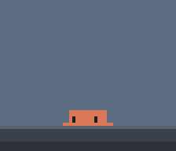<br>Peek</td>
    <td align="center">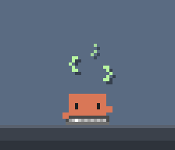<br>Typing</td>
    <td align="center">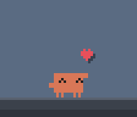<br>Wave</td>
    <td align="center"><br>Dance</td>
  </tr>
  <tr>
    <td align="center"><br>Sleep</td>
    <td align="center">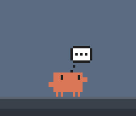<br>Think</td>
    <td align="center">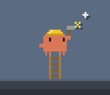<br>DIY on a ladder</td>
    <td align="center">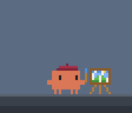<br>Painter</td>
  </tr>
  <tr>
    <td align="center"><br>Magician</td>
    <td align="center"><br>Cook</td>
    <td align="center">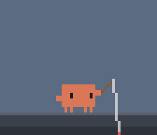<br>Fishing</td>
    <td align="center"><br>Reading</td>
  </tr>
  <tr>
    <td align="center">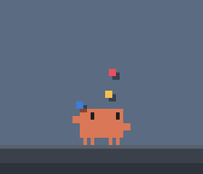<br>Juggling</td>
    <td align="center">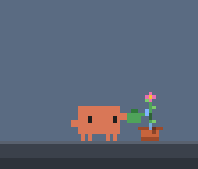<br>Watering the plant</td>
    <td align="center">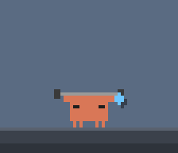<br>Fitness</td>
    <td align="center"><br>Skateboard</td>
  </tr>
  <tr>
    <td align="center">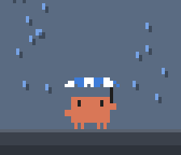<br>Rain</td>
    <td align="center">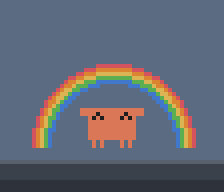<br>Rainbow</td>
    <td align="center">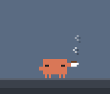<br>Coffee</td>
    <td align="center"><br>Parachute</td>
  </tr>
  <tr>
    <td align="center"><br>Dizzy</td>
    <td align="center">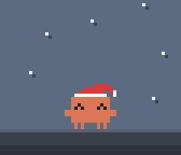<br>December</td>
    <td align="center">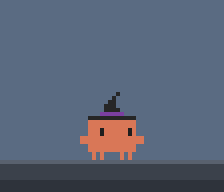<br>Halloween</td>
    <td align="center">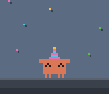<br>Party day</td>
  </tr>
</table>

The pictures are drawn by the same code as the app (`src/Canvas.cpp`). To draw them again:
`cmake --build build --target render_poses`, then `build\render_poses.exe art\poses`
(after `build.cmd`, in a shell where the MSVC tools are set up).
