# StrayClawd: a desktop pet for Windows

<p align="center">
  
</p>

StrayClawd is a free desktop pet (a screen mate, or virtual pet) for Windows 10 and 11, in
the spirit of the old [Screen Mate Poo](https://github.com/lwu309/Scmpoo), eSheep and
Shimeji: the small orange pixel crab of Claude appears at random from behind one of your
windows, sits on its title bar, codes on a tiny laptop and does small cute things, then
hides again.

<p align="center">
  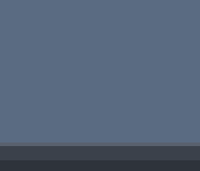
</p>

## Download

Get `clawdmate.exe` from the [latest release](https://github.com/dwerbin/strayclawd/releases/latest)
and run it. One small file, no install, Windows 10/11 x64. The crab shows up after 3 s; right
click its tray icon for the menu.

## Features

- Lives on your window title bars and on the taskbar; follows a window when you move it and
  falls when it closes.
- More than 30 animations: typing, dancing, sleeping, DIY, painter, wizards, cooking,
  fishing, juggling, a plant that grows and explodes, skateboard, rocket, yoga, cleaning and
  more (see the [gallery](#gallery)).
- Reacts to the mouse: stares at the cursor, chases it, waves at it, gets dizzy.
- Drag and throw it; it lands on the next window below.
- Run it several times for several crabs. When two crabs are close, they play together: talk,
  toast, cook, juggle, dance, high five, build a big rocket, fix a huge leaking bomb, fight
  with light sabers, pray to Saint Algo...
- Configure the chance of each animation, or turn it off.
- Time of day and seasons: coffee in the morning, nightcap at night, Santa hat in December,
  witch hat at Halloween.
- Tiny and light: one exe, no install, no external library.

## Build

Needs Visual Studio 2026 (or Build Tools 2026) with the C++ x64 tools, and CMake.

```
build.cmd
```

Output: `build\clawdmate.exe`. `build.cmd` finds MSVC with vswhere. If vcvars does not find
the Windows SDK (missing registry entry), it takes the newest SDK found under
`C:\Program Files (x86)\Windows Kits\10`.

## Run

Start `build\clawdmate.exe`. The crab shows up after 3 s, then at random times.
Start the exe again to add another crab: each one has its own tray icon. A crab never uses
another crab as a surface.

Tray icon (right click):

- Show now / Hide
- Play: start an animation now (Peek, Parachute, DIY on a ladder, Paint, Magic, Magic: young
  wizard, Magic: grey wizard, Cook, Dizzy, Fishing, Reading, Juggling, Watering the plant,
  Fitness, Skateboard, Rain and rainbow, Coffee, Yawn, Rocket, Dusting, Sweeping,
  Yoga). "With another crab" starts a duo with the nearest crab on the same edge (up to about
  400 px away); a "?" means no crab is there, or it is busy.
- Type along with me / Today is a party day
- Frequency: Rare (5-15 min), Normal (1-5 min), Often (20-60 s)
- Pause
- Start with Windows (`HKCU\Software\Microsoft\Windows\CurrentVersion\Run\StrayClawd`)
- Configure...: one row per animation. The checkbox turns it on or off. Select one or more
  rows and move the slider to set their weight. Activities and duos: the chance of a row is
  its weight divided by the total of its group. Events (parachute, side peek, shy peek,
  stare, chase, duo) are a percent. OK saves and updates all the running crabs.
- Quit

Double click on the tray icon = Show now. Right click on the crab opens the same menu.
Settings are stored in `HKCU\Software\StrayClawd` (the animations in its `Animations` subkey).

## What the crab does

- Peeks from behind the top edge of a window (or from behind its left/right side), looks
  around, sometimes gets shy and goes back, otherwise climbs out with a hop.
- Then 4 to 8 activities: coding on a laptop (code glyphs pop up), walking along the edge,
  waving at the mouse, following the mouse with its eyes, dancing, sleeping (wakes up when
  the mouse comes close), thinking, sneezing.
- Short special animations, picked at random among the activities:
  - DIY: puts on a hard hat, climbs a small ladder and hammers; the ladder vanishes and he
    falls down, dizzy for a moment.
  - Painter: beret and brush; he looks toward the wallpaper and paints a small copy of your
    real wallpaper on an easel.
  - Magician: top hat and wand; shooting stars, then a bow.
  - Young wizard: round glasses, a scar and a red and gold scarf; he casts red and gold
    spells with his wand, then takes a short ride on a broom.
  - Grey wizard: pointed grey hat, long white beard and a staff; the staff lights up, he
    strikes the ground, then sends fireworks into the sky.
  - Cook: chef toque and a frying pan; vegetables jump in the pan, steam rises.
  - Fishing from the window edge: the line goes down into the window; a fish or an old boot.
  - Reading with glasses, the book held up in front of him, turning pages.
  - Juggling three balls; sometimes one falls on his head.
  - Watering a small plant. It grows one step per watering: a flower at step 4, a big
    flower at step 5. At step 6 the flower explodes; he is dizzy for a moment, and the
    plant starts again from an empty pot.
  - Fitness: push-ups, then a barbell, with sweat drops.
  - Skateboard along the edge, over a long distance, with a jump at the end. If he reaches
    the end of the window, he rolls on in the air, stops, looks down, sees there is nothing
    under his feet and falls in a panic, cartoon style.
  - Rain: he opens an umbrella; the drops splash on it and run off its edges, so he stays
    dry. Then a rainbow appears.
  - Rocket: he builds a small rocket next to him with a hammer, jumps on it (seen from the
    back, so no eyes), counts down 3, 2, 1, and takes off; he leaves the screen by the top and comes back later.
  - Dusting: a feather duster, on one side then the other; the dust makes him sneeze.
  - Sweeping: he walks along the edge with a broom and pushes a growing pile of dust, then
    sweeps it over the edge and wipes his brow.
  - Yoga: he unrolls a mat and puts on a headband; arms up while breathing, the tree pose
    (he almost loses his balance), the warrior pose, then he floats above the mat in a lotus
    pose. He greets you with a heart and rolls the mat up.
- Time of day: coffee in the morning (6-11 h), yawns after lunch and in the evening, more
  sleep and a nightcap at night (21-6 h).
- Seasons: Santa hat, white beard and snow in December, witch hat from 24 to 31 October, party hat and
  confetti on 1 January and on your party day (tray: "Today is a party day").
- He sits more often on the window you are using.
- Sometimes, when the cursor comes near and just above him, he chases it along the edge and
  jumps to catch it.
- "Type along with me" (tray, off by default): when you type, he types with you, one claw
  per key press. It uses a low-level keyboard hook that only counts key presses; it never
  reads which key.
- Sometimes, when the cursor comes near, he stops and stares at it. Not every time: 30 %
  chance, then a pause of 15-30 s. If you circle the cursor around him while he stares, he
  gets dizzy.
- Sometimes (15 % of the visits) he arrives by parachute from the top of a screen down to
  the taskbar.
- If another window covers him for 2 s, he leaves and comes back elsewhere a bit later.
- Waves goodbye and slides back behind the window.
- If no window edge is free (for example a maximized window), it uses the top of the taskbar.
- Follows the window when you move it. Falls when the window is minimized or closed.
- Click: hop with hearts, happy wiggle, or it runs away.
- Drag and drop: grab it, throw it; it lands on the first window top edge below, or on the
  taskbar.

## Two crabs together

When two crabs sit on the same edge, not too far from each other, one of them sometimes
asks the other for a duo (40 % per activity by default, then a pause of 20-40 s). They
walk to each other, then:

- Look at each other, wave at each other.
- Talk: "..." speech bubbles above their heads, each one in turn, then they laugh.
- Juggle together: the balls fly from one crab to the other.
- Cook together: chef toques and a pot between them; one stirs, the other throws in the
  vegetables.
- Build the big rocket (tech 2, a Saturn V look-alike about three crabs high): one crab
  plants a "/!\" danger sign, both hammer, the rocket grows stage by stage, countdown, and
  both fly away holding on to it.
- Fix a huge leaking atomic bomb: a puddle of neon green liquid grows on the ground; one
  crab tinkers with a wrench and sweats, the other sips from a mug and says "THIS IS
  FINE.". Then the bomb rattles and explodes like in a comic: flash, spiky starburst with a
  big "BOOM!", then round puffs of smoke that shrink away. Both crabs are gone.
- Toast with their mugs.
- Scheme: sly eyes, whispers, claws rubbed together, then they look at you.
- Light saber duel: blue against red, with sparks when the blades cross.
- Boost: one crab gives the other a leg up onto a window above (only when there is one).
- Dance together, mirrored.
- Pray to Saint Algo: occult robes with glowing eyes, an altar with candles and a floating
  golden `{ }`.
- High five: they crouch, jump, and slap their claws together at the top of the jump.

The crabs find each other by their window class and talk with window messages (ask, accept,
decline, end). The one that asks leads: it sends the meeting point and the walk time, and
draws the shared props (pot, rocket, bomb, altar, sign, balls). The big rocket and the bomb
do not fit in a crab window: the leader draws them in a second click-through window, kept
just below both crabs. If one of them is dragged, clicked or hidden, the other stops too.

## How it works

Pure Win32 + GDI, C++20, no external library.

- `src/Mate.cpp`: layered window (`UpdateLayeredWindow`, per-pixel alpha), the state machine
  and the activities. To "come from behind" a window, the crab window is put just below the
  target window in the z-order (`SetWindowPos(crab, target)`), then slides up: Windows draws
  the real window over the hidden part. Once out, it is kept just above the target.
- `src/Canvas.cpp`: the crab is drawn in code, pixel by pixel, from a `Pose` (eyes, claws,
  legs, body). Scale 4 at 100 % DPI, per-monitor DPI aware.
- `src/Scanner.cpp`: `EnumWindows` + DWM frame bounds, in z-order, to find visible edges.
- `src/Tray.cpp`, `src/Settings.cpp`: tray icon, menu, registry.
- `src/ConfigDialog.cpp`: the Configure dialog (list view and slider).

## Gallery

<table>
  <tr>
    <td align="center"><br>Peek</td>
    <td align="center"><br>Coding</td>
    <td align="center"><br>Wave</td>
    <td align="center">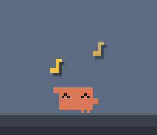<br>Dance</td>
  </tr>
  <tr>
    <td align="center">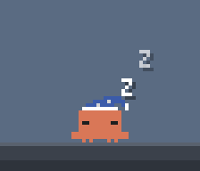<br>Sleep</td>
    <td align="center"><br>Think</td>
    <td align="center"><br>DIY on a ladder</td>
    <td align="center"><br>Painter</td>
  </tr>
  <tr>
    <td align="center">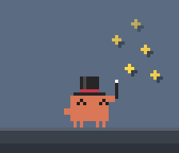<br>Magician</td>
    <td align="center">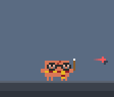<br>Young wizard</td>
    <td align="center">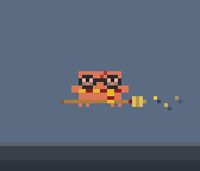<br>Young wizard on a broom</td>
    <td align="center">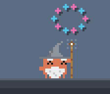<br>Grey wizard</td>
  </tr>
  <tr>
    <td align="center">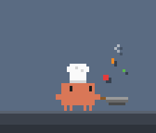<br>Cook</td>
    <td align="center"><br>Fishing: a fish</td>
    <td align="center">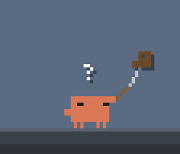<br>Fishing: an old boot</td>
    <td align="center">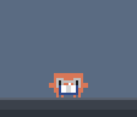<br>Reading</td>
  </tr>
  <tr>
    <td align="center"><br>Juggling</td>
    <td align="center"><br>Watering the plant</td>
    <td align="center">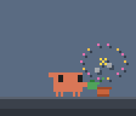<br>Watering: the flower explodes</td>
    <td align="center">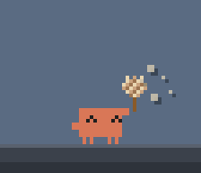<br>Dusting</td>
  </tr>
  <tr>
    <td align="center">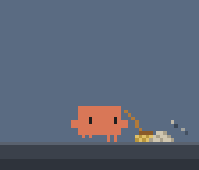<br>Sweeping</td>
    <td align="center">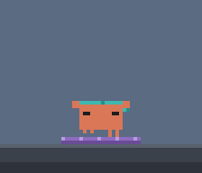<br>Yoga: tree pose</td>
    <td align="center">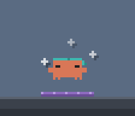<br>Yoga: floating lotus</td>
    <td align="center"><br>Fitness</td>
  </tr>
  <tr>
    <td align="center">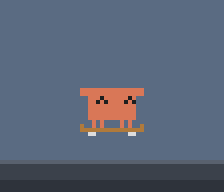<br>Skateboard</td>
    <td align="center">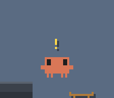<br>Skateboard: off the edge</td>
    <td align="center"><br>Rain</td>
    <td align="center"><br>Rainbow</td>
  </tr>
  <tr>
    <td align="center"><br>Coffee</td>
    <td align="center">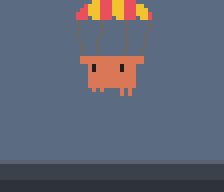<br>Parachute</td>
    <td align="center">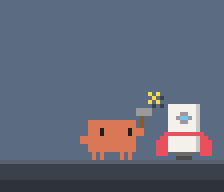<br>Rocket: building</td>
    <td align="center">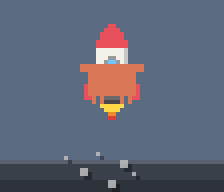<br>Rocket: takeoff</td>
  </tr>
  <tr>
    <td align="center">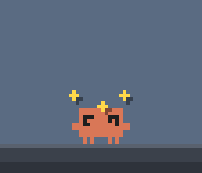<br>Dizzy</td>
    <td align="center"><br>December</td>
    <td align="center"><br>Halloween</td>
    <td align="center"><br>Party day</td>
  </tr>
  <tr>
    <td align="center">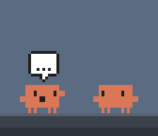<br>Duo: talk</td>
    <td align="center">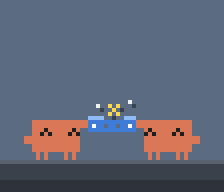<br>Duo: toast</td>
    <td align="center">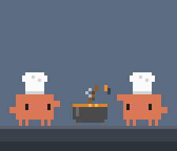<br>Duo: cook</td>
    <td align="center">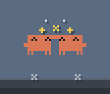<br>Duo: high five</td>
  </tr>
  <tr>
    <td align="center">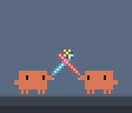<br>Duo: light sabers</td>
    <td align="center">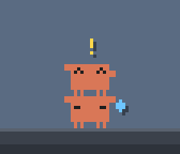<br>Duo: boost</td>
    <td align="center">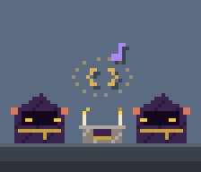<br>Duo: Saint Algo</td>
  </tr>
  <tr>
    <td align="center" colspan="2">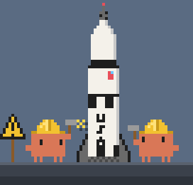<br>Duo: big rocket</td>
    <td align="center" colspan="2">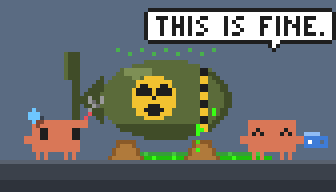<br>Duo: this is fine</td>
  </tr>
  <tr>
    <td align="center" colspan="4">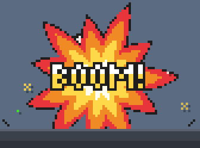<br>Duo: this was not fine</td>
  </tr>
</table>

The pictures are drawn by the same code as the app (`src/Canvas.cpp`). To draw them again:
`cmake --build build --target render_poses`, then `build\render_poses.exe art\poses`
(after `build.cmd`, in a shell where the MSVC tools are set up). For the animated GIF:
`build\render_poses.exe --clips frames.bin`, then
`python tools\make_gif.py frames.bin art\strayclawd.gif` (Python 3, no extra package).
